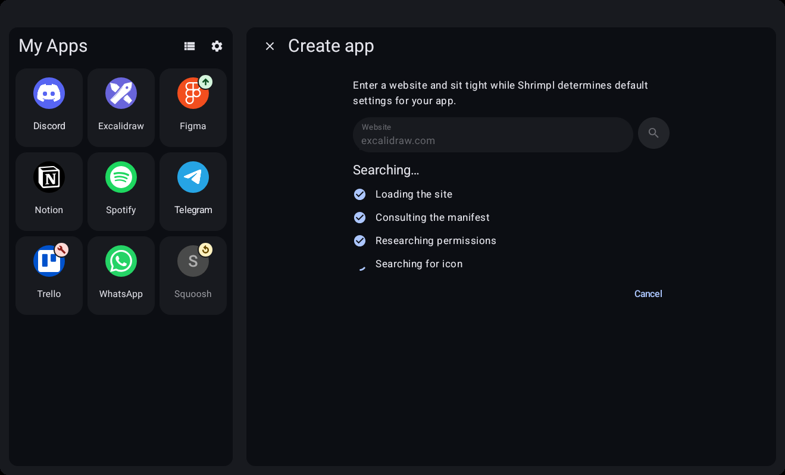
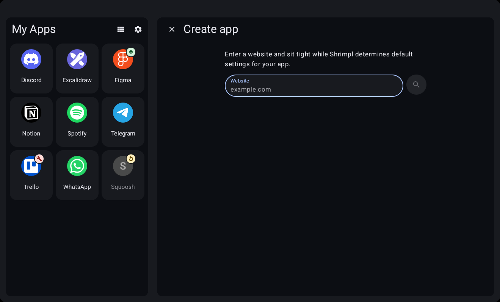
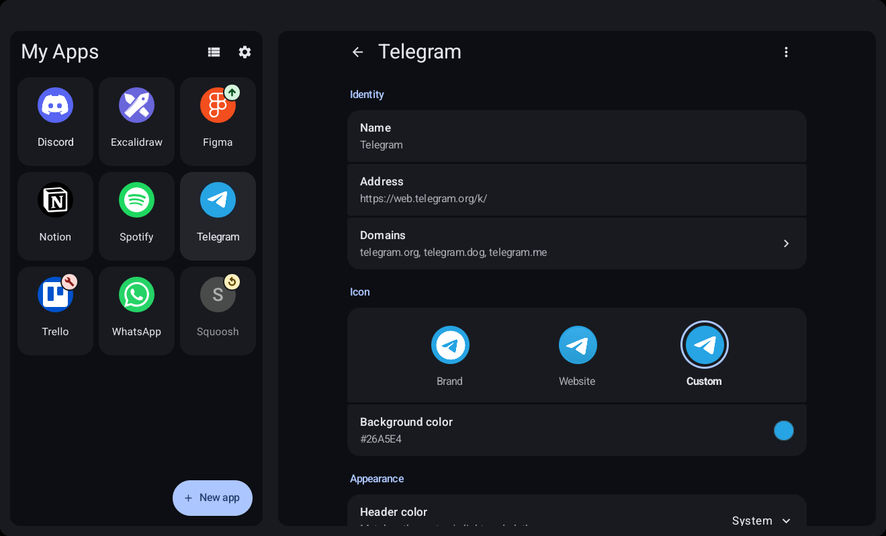
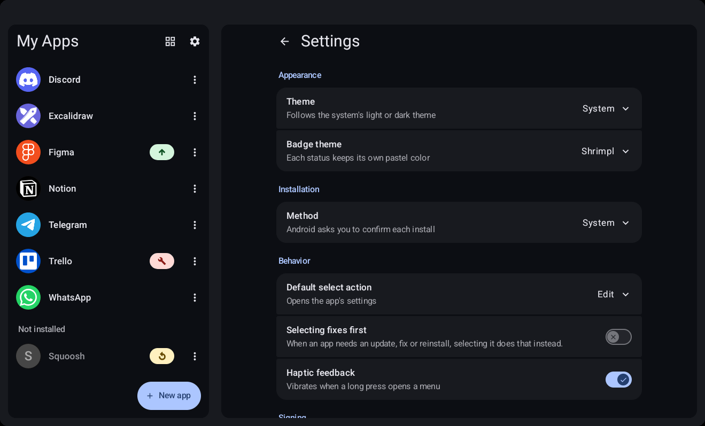
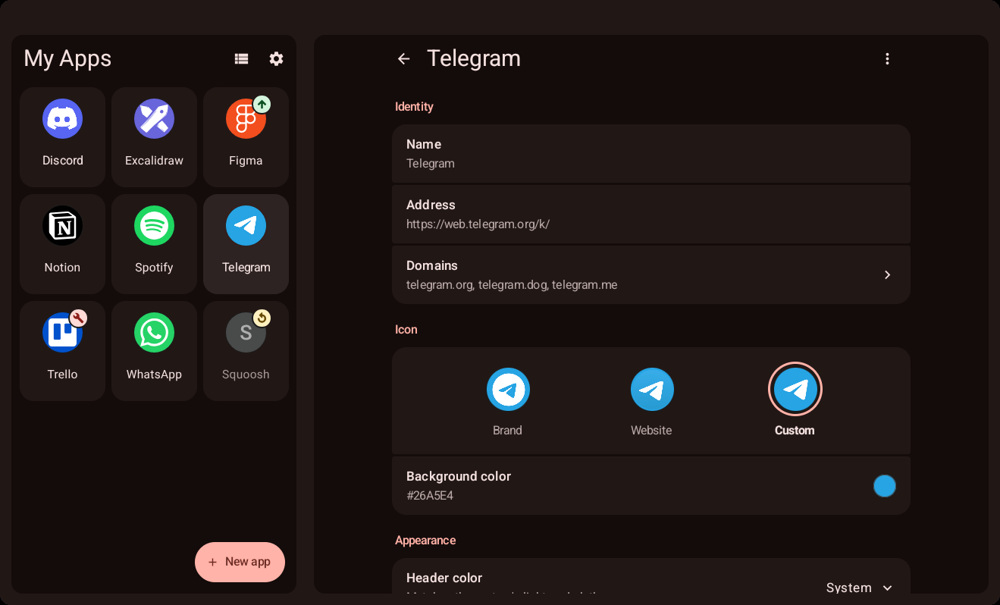
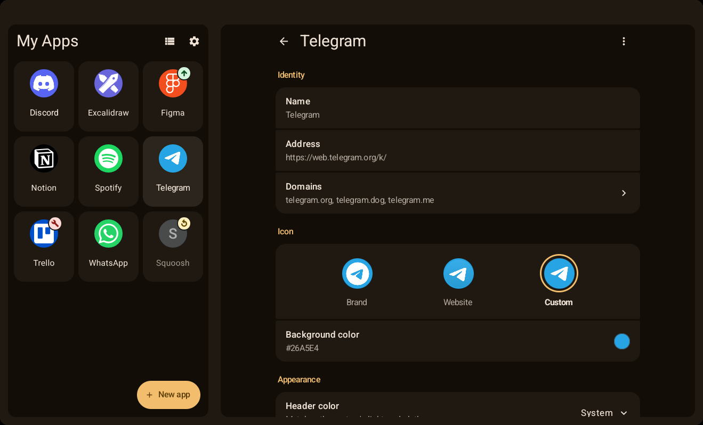
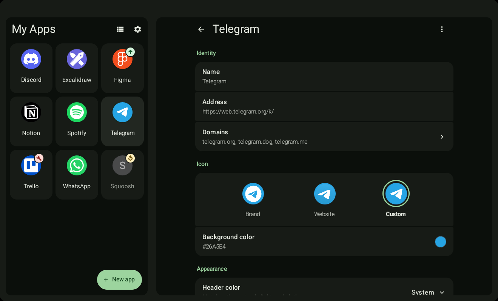

# Shrimpl

**Any website, as a real Android app, made on your device, to your specifications.**

Shrimpl is a PWA generator and manager. Provide a website and it will pick a name, generate an icon, determine the brand colors, and recommend the permissions the site needs. Modify anything to your liking, and let Shrimpl build you an APK straight from your device.

  

## Features

- **Built on your device:** builds, signs, installs and updates apps right on your device, with no computer needed. Shevery or Root installs skip Android's confirmation prompts.
- **Desktop-class apps:** each app gets its own windows, launcher icon and dock pin, keyboard shortcuts, notifications, downloads and file access.
- **Customize everything:** brand glyphs, icon packs and themed icons, plus headers that follow your system theme, the site's colors or a color you choose.
- **Edit anytime:** change anything later and keep your sign-ins and data intact.
- **Stays current:** Shrimpl checks for its own updates on your schedule and keeps your apps updated as Shrimpl improves.
- **Every form factor:** designed for Googlebooks and adaptive on phones, tablets and foldables, following Google's Material 3 and adaptive design guidance.
- **Architecture neutral:** runs natively on ARM and x86, 32 and 64 bit, with no translation layer.
- **Accessible:** screen reader labels, easy touch targets, full keyboard use, and WCAG AAA contrast.
- **Privacy-first:** no accounts, analytics or ads, ever.

<table>
  <tr>
    <td></td>
    <td></td>
    <td></td>
  </tr>
</table>

More themes

| Red | Yellow | Green |
|---|---|---|
|  |  |  |

## How is Shrimpl different from installing apps via Chrome or another wrapper?

Chrome can install any site as a web app (a PWA), and on a phone that's often enough. Shrimpl was made for the friction this causes on Googlebooks, where web apps sit in windows beside everything else. Chrome makes the app for you, so how it looks and how well it fits into Android are mostly up to the site and to Chrome, not to you. For example:

- **Icons may be missing or ugly.** Chrome uses whatever icon the site's manifest offers. A site without a good one gets a blurry or generic icon, often shrunk onto a white circle, and you can't pick another.
- **Window borders often ignore the system theme.** The title bar takes the site's single theme color, so a bright bar can sit on a dark desktop, or a dark one on a light desktop.
- **The name, icon and colors are fixed.** They come from the site, and you can't change them after installing.
- **It shares your browser.** The app uses Chrome's cookies and storage, so it's signed in to the same account as your browser, and you can't keep two accounts of one service side by side.
- **The site decides how well it works.** Some sites push you to their store app instead, and sites without a web manifest install as a bare page with a poor icon and name.
- **Other wrapper apps don't always behave like real apps.** Many run every site under their own app's identity, so Android treats all those sites as one app: their windows mix in the recents menu, and pinning one to the dock pins the wrapper instead of the site.

Shrimpl puts you back in control:

- **You pick the icon.** Choose the brand's glyph, the site's own icon, a standalone image, or an icon pack. Shrimpl turns it into a proper adaptive icon, with the monochrome layer Android's themed icons use.
- **The header follows your theme.** The title bar and system bars use your light or dark theme, the site's own colors or a color of your choosing.
- **Change anything later.** Rename, recolor or re-icon an app at any time; it updates in place and stays signed in.
- **Every app stands alone.** Each site becomes its own Android app, with its own storage and sign-ins, its own windows, its own entry in recents and its own pin on the dock.
- **It works around the site.** When a site has no web manifest, Shrimpl finds a name, icon and colors from the page itself. When a site sends you to the Play Store, the app switches to the desktop site instead.

## Limitations

- **No Google sign-in:** Google blocks it inside embedded browsers, and workarounds put your account at risk.
- **No background push:** notifications arrive only while the app is running and awake.
- **WebView gaps:** no Push API, WebUSB, Web Bluetooth or some passkey flows.
- **Sideloaded:** some certified devices will warn about or block installs from outside an app store.
- **Personal use:** don't publish apps of other people's services.

## Credits and license

Shrimpl is licensed under the [Apache License 2.0](LICENSE) and was co-developed with Claude.

A huge thanks to the following projects:

- [Android Jetpack](https://developer.android.com/jetpack) (AndroidX, Jetpack Compose, Material 3, Navigation 3, WorkManager, WebKit) and [Material Components](https://github.com/material-components/material-components-android), Apache License 2.0
- [apksig](https://android.googlesource.com/platform/tools/apksig/) from the Android Open Source Project, which signs and verifies the apps, Apache License 2.0
- [kotlinx.serialization](https://github.com/Kotlin/kotlinx.serialization), Apache License 2.0
- [Shevery-API](https://github.com/HmnDev-Tech/Shevery-API) by HmnDev-Tech, for installs without prompts, MIT License
- The [Public Suffix List](https://publicsuffix.org) from Mozilla, bundled to tell a site's domains apart, Mozilla Public License 2.0
- [simple-icons](https://simpleicons.org), whose brand glyphs Shrimpl looks up when you make an app (none are bundled), CC0 1.0. The brands themselves are trademarks of their owners, used under their own guidelines.
- Google's [Android skills](https://github.com/android/skills), vendored in `.claude/skills/` to guide the work on this project, Apache License 2.0
- Tests use [JUnit](https://junit.org/junit4/), Eclipse Public License 1.0, and [Robolectric](https://robolectric.org), MIT License

Shrimpl isn't affiliated with Google or with any of the sites people make apps for.

## For developers

### How it works

- `template/`: the web app (Kotlin, AndroidX Views, WebView). It reads its site from `assets/shrimpl/profile.json` and declares every capability any site may need. Its release APK is bundled inside Shrimpl.
- `core/`: pure-JVM logic, unit tested with a 95% line-coverage rule: URL routing, zoom, keys, user agent and wake state for the web app; the profile model and validator; discovery rules; and the builder that patches the template's manifest (package, label, versions, permissions, window sizes), replaces the profile and icons, and signs with apksig.
- `shrimpl/`: the manager app in Compose (Material 3, Navigation 3 with a list-detail layout on wide windows): discovery (a page fetch plus a hidden WebView), the icon renderer, the record store, the signing key in the Android Keystore, and the System, Shevery and Root installers.
